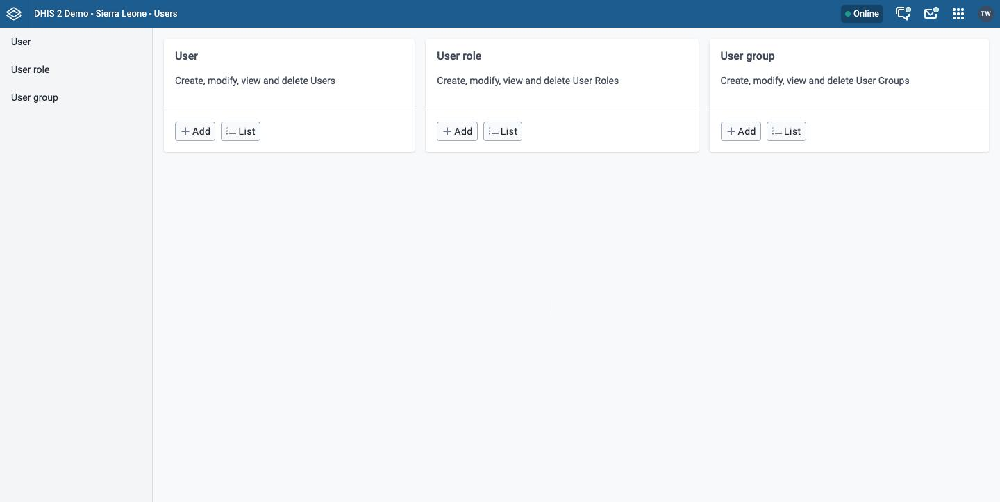
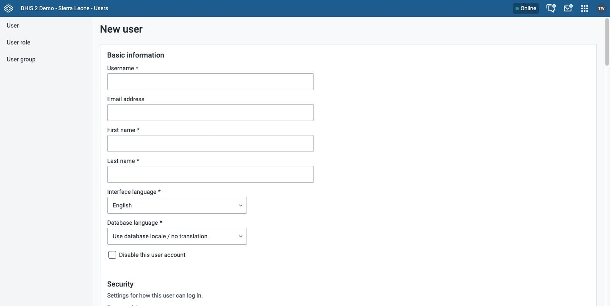
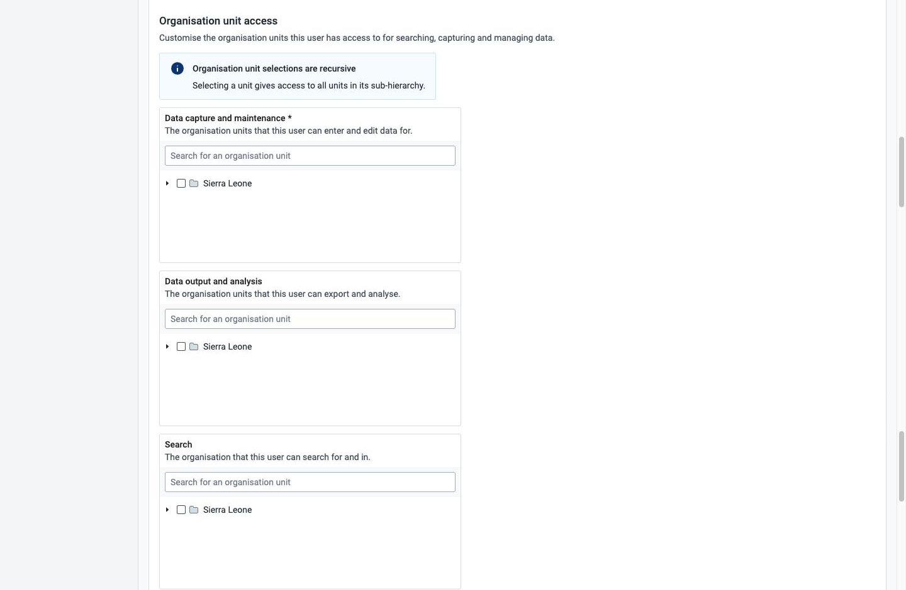
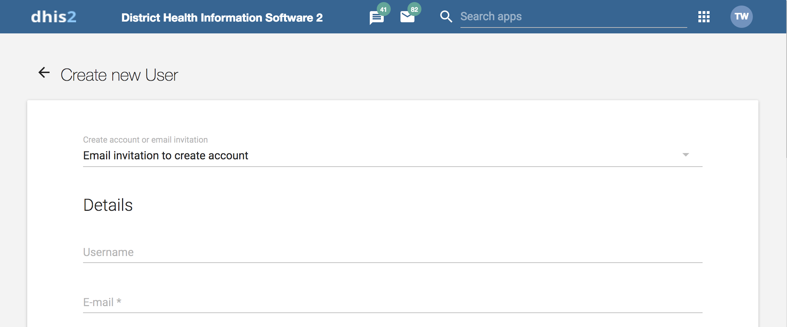
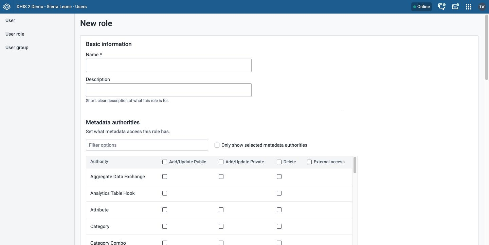

# Users { #users_app }

The Users app lets you create and manage users, user roles and user groups. You open it from the apps menu. The sidebar has three pages: **User**, **User role** and **User group**. The app shows only the pages that your authorities allow. The home page shows a card for each page, with a **List** link and, if you can create items, an **Add** link.

For background on how users, roles and groups work together, see [Understanding users, user roles, and user groups](#understanding_user_management). For how to give user management to regional or district administrators, see [Understanding decentralized user management](#decentralize_user_management).

## Manage users { #mgt_user }

### Create a user { #create_user }

1.  Open the **Users** app, click **User**, and then click **New**.

    The **New user** form opens. It has the sections **Basic information**, **Security**, **Contact details**, **Organisation unit access**, **Roles and groups** and **Analytics dimension restrictions**. If the system has custom attributes for users, the form also has an **Attributes** section. A star after a field name means that the field is required.

    

    > **Note**
    >
    > If the system has a valid email configuration, the form starts with the section **Invite user**. Its field **Create account or email invitation** has two options: **Create account with user details** (the default) and **Email invitation to create account**. If you choose the invitation, see [Invite a user by email](#invite_user). An administrator sets the email configuration in the **System Settings** app.

2.  In **Basic information**, enter the **Username**, the **First name** and the **Last name**. Optionally, enter an **Email address**.

    #### Username requirements { #username_requirements }

    The following rules apply when you create a new username. The username must:

    -   Contain at least 4 characters.

    -   Not contain more than 255 characters.

    -   Contain lowercase and UPPERCASE Latin characters and numbers (`a-z`,`A-Z`,`0-9`).

    -   These characters are also allowed: `.`, `_`, `-` and `@`. Use them only as separators. Do not use them as a leading or trailing character, and do not put two of them next to each other (for example, `user@@name` and `user._name` are not allowed).

3.  Choose an **Interface language**.

    You can choose one of the languages that the fixed elements of the DHIS2 user interface are translated into.

4.  Choose a **Database language**.

    You can choose one of the languages that implementation-supplied items in the database are translated into, for example data element names or organisation unit level names. The default is **Use database locale / no translation**.

5.  (Optional) To create the account in a disabled state, choose **Disable this user account**.

6.  In **Security**, enter a **Password** and enter it again in **Repeat password**. See [Password requirements](#password_requirements).

7.  (Optional) In **Security**, enter an **Account expiration date**. See [Set account expiration date](#user_account_expiration_date).

8.  (Optional) In **Security**, enter values for **OIDC mapping value** and **LDAP identifier**. Choose **External authentication only (OpenID / LDAP)** if the user must log in only through an external provider. When you choose this option, the password fields in **Security** are hidden.

9.  (Optional) In **Contact details**, enter values for **Mobile phone number**, **WhatsApp**, **Facebook Messenger**, **Skype**, **Telegram** and **Twitter**.

10. In **Organisation unit access**, choose the organisation units for the user. The form shows three organisation unit trees:

    

    -   **Data capture and maintenance** (required): The organisation units that the user can enter and edit data for. You must assign at least one organisation unit to each user. Users have access to all sub-organisation units of the assigned organisation units. For example, if you assign a user to a district that has several facilities, the user has access to the data of the district and of all the facilities in the district.

    -   **Data output and analysis** (optional): The organisation units that the user can export and analyze data for, for example in the **Data Visualizer** and **Maps** apps. You can assign any number of organisation units. Users have access to all sub-organisation units of the assigned organisation units. Do not choose the descendants of an organisation unit that you already chose. For example, if you assigned the user to a district, do not choose the facilities in that district.

    -   **Search** (optional): The organisation units that the user can search in, for example for tracked entities. The user can always search in the data capture and maintenance organisation units. If you choose search organisation units, a search uses the data capture and maintenance organisation units plus the search organisation units. This behavior applies from DHIS2 v42.

    Each tree has a search field, **Search for an organisation unit**. You can also set the **Maximum organisation unit level for data output**.

    > **Note**
    >
    > Assigning data output and analysis organisation units is optional. If you do not specify any organisation unit, the user has access to the full organisation unit hierarchy for viewing aggregated data. As with the data capture organisation units, _do not choose descendant organisation units of a unit that you already chose_.
    >
    > In several places in the analytics apps, you can choose "user organisation unit" for the organisation unit dimension. This mechanism first tries to use the data output and analysis organisation units linked to the current user. If it finds none, it uses the data capture and maintenance organisation units. If the user is assigned to multiple organisation units, using "user organisation unit" might cause unpredictable behavior.

11. In **Roles and groups**, in **Available user roles**, double-click the user roles you want to assign to the user. They move to **User roles this user is assigned**. You must assign at least one user role.

    > **Note**
    >
    > You can assign only the user roles that you are allowed to assign. You cannot assign a user role that has authorities that you do not have. If the system setting **Allow users to grant own user roles** is off, you also cannot assign a user role that you are a member of yourself. If a user already has a role that you cannot assign, the form shows the message **You do not have permission to assign certain user roles** and the name of the role.

12. (Optional) In **Available user groups**, double-click the user groups you want to assign to the user. They move to **User groups this user is a member of**.

13. (Optional) In **Analytics dimension restrictions**, in **Available restrictions**, double-click the dimensions you want to assign to the user. They move to **Selected restrictions**.

    You can restrict the values the user sees in data analytics apps by choosing dimensions that restrict the user's view.

    > **Example**
    >
    > Suppose you have defined _Implementing Partner_ as a category option group set, and you have shared with this user only one or more specific implementing partners (category option groups). If you want to make sure that the user does not see totals in analytics that include values from other groups, assign _Implementing Partner_ to the user.
    >
    > Then the analytics apps show the user only data from the Implementing Partner category option group(s) that the user can see.

14. Click **Create user**. To leave the form without saving, click **Cancel without saving**.

After you create the user, the account is ready to use with the username and password that you provide.

> **Note**
>
> The Users app creates one user at a time. The **Import/Export** app cannot import users from a CSV file, because the list of object types for CSV metadata import (**Class key**) does not include users. To create or invite many users at once, use the Web API. See [User account create and update](https://docs.dhis2.org/en/develop/using-the-api/dhis-core-version-master/users.html#webapi_users_create_update) and [User account invitations](https://docs.dhis2.org/en/develop/using-the-api/dhis-core-version-master/users.html#webapi_user_invitations).

### Invite a user by email { #invite_user }

> **Note**
>
> This option is available only when the system has a valid email configuration.

1.  Open the **Users** app, click **User**, and click **New**. In **Invite user**, in **Create account or email invitation**, choose **Email invitation to create account**.

    

2.  In **Basic information**, enter the **Email address** to send the invitation to. The email address is required. You can also enter the **Username** for the account. If you leave the username empty, the user can choose their own username when they respond to the invitation, if no other user has it already.

3.  Set the other options for the account, such as the user roles and organisation units, as in [Create a user](#create_user). The **Security** section does not show for an invitation. The account is limited according to how you configure it.

4.  Click **Send invite**. To leave the form without sending, click **Cancel invite**.

The system sends an email to the address you provided. It contains a unique web link. The user can use the link to return to the system and activate their account by entering the rest of their user information. The user must finish setting up the account within 7 days. After that, the invitation becomes invalid. To find invitations that have expired, use the **Invitation** filter in the user list.

The Users app cannot resend an invitation. If an invitation expired, or you sent it to the wrong email address, delete the user and create a new invitation.

### Edit user { #edit_user }

1.  Open the **Users** app and click **User**.

2.  In the user list, click the user you want to edit, or click the **Actions** menu (**...**) and choose **Edit**.

3.  Modify the options you want. The **Edit user** form has the same sections as the **New user** form, except **Invite user**. You cannot change the **Username**.

4.  Click **Save changes**.

### Set account expiration date { #user_account_expiration_date }

To make a user account expire on a specific date, set an account
expiration date for the user. The **Account expiration date** field is optional.

1.  Open the **Users** app and click **User**.

2.  Click the user whose account needs an expiration date.

3.  In **Security**, in **Account expiration date**, enter the date.

4.  Click **Save changes**.

### Disable user { #disable_user }

You can disable a user. This means that the user's account is not
deleted, but the user cannot log in or use DHIS2.

1.  Open the **Users** app and click **User**.

2.  In the list, click the **Actions** menu (**...**) of the relevant user and choose **Disable**.

3.  Click **Yes, disable** to confirm.

To enable a disabled user again, click the **Actions** menu, choose **Enable**, and click **Yes, enable**.

You can also disable a user in the **Edit user** form: in **Basic information**, choose **Disable this user account**, and click **Save changes**. You cannot disable your own account.

> **Warning**
>
> If you use the [Android Capture app](https://www.dhis2.org/android), disabling a user causes the Android app to delete the local data stored on the phone the next time the user tries an online login. Before you disable a user, make sure that all the data is synced with the server. The only exception is when you use this function to delete the data on a lost device.

### Show user profile { #display_user_profile }

1.  Open the **Users** app and click **User**.

2.  In the list, click the **Actions** menu (**...**) of the relevant user and choose
    **Profile**.

    The **Profile** page shows the display name of the user and the sections **Overview**, **Contact**, **Permissions** and **Profile**.

    -   **Overview** shows the **ID**, **Username**, **Last login**, **Created**, **First name** and **Last name**. Click **Edit user** to open the **Edit user** form.
    -   **Contact** shows the email address and the mobile phone number. Click **Send message** to send a message to the user.
    -   **Permissions** shows the organisation units and the user roles of the user.
    -   **Profile** shows personal details, such as **Job title**, **Gender** and **Birthday**.

### Filter users { #filter_users }

The user list has these filters above the table: a **Search by name** field, **Org.unit**, **Time inactive**, **Invitation**, and **Show self-registrations**. If the system has email configured and runs DHIS2 v42 and later, an **Email verification** filter also appears. The list shows the columns **Display name**, **Username**, **Last login**, **Status** and **Actions**.

The filters work as follows:

-   **Search by name**: Enter part of a name to show only users with a matching name.
-   **Time inactive**: Choose 1 to 12 months to show only users who have not logged in during that time.
-   **Invitation**: **All invitations** shows only users that were invited by email. **Expired invitations** shows only invited users whose invitation has expired.
-   **Show self-registrations**: Shows only users who registered themselves.
-   **Clear filters**: Removes all filters.

To change the sort order, click the sort icon in the **Display name** column. To open a user, click the user. If you can only view the user, the **Profile** page opens. Otherwise, the **Edit user** form opens.

#### Filter users by organisation unit

You can view all users who are assigned to a particular
organisation unit.

1.  Open the **Users** app and click **User**.

2.  Click the **Org.unit** filter.

3.  In the pop-up that opens, choose the organisation units
    you want to filter by.

The list of users shows only the users who are
assigned to the selected organisation units.

#### Filter users by email verification

You can filter users based on whether their email address is verified or not. This feature is available when the system has email configured and runs DHIS2 v42 and later.

1. Open the **Users** app and click **User**.

2. Find the dropdown filter **Email verification**. It is located between the **Time inactive** and **Invitation** filters.

3. Click the **Email verification** dropdown to see the available options:

    - **All**: Shows all users, regardless of their email verification status.
    - **Email verified**: Shows only users with a verified email address.
    - **Email not verified**: Shows only users with an unverified email address.

4. Choose the option you want from the dropdown to filter the list of users.

An **Email verification** column appears in the users list table, between **Status** and **Last login**. The two possible statuses are:

-   **Verified**: The email address of the user is verified.
-   **Not verified**: The email address of the user is not verified.

##### v41 and earlier { #email_verification_v41_and_earlier }

In DHIS2 v41 and earlier, the Users app does not show the **Email verification** filter or the **Email verification** column.

### Replicate user { #clone_user }

1.  Open the **Users** app and click **User**.

2.  In the user list, click the **Actions** menu (**...**) of the relevant user and
    choose **Replicate**.

3.  Enter a new username and password for the cloned user account.

4.  Click **Replicate user**.

5.  In the user list, click the user you just created.

6.  Modify the options you want.

7.  Click **Save changes**.

> **Note**
>
> The **Replicate** option is available only to users who have the **Replicate user** authority or the **ALL** authority.

### Change user password { #user_manage_password }

To change a user's password:

1.  Open the **Users** app and click **User**.

2.  In the user list, click the user you want to edit, or click the **Actions** menu (**...**) and choose **Edit**.

3.  In **Security**, choose **Change user password**.

4.  Enter the new password in **New password** and enter it again in **Repeat new password**.

5.  Click **Save changes**.

#### Password requirements { #password_requirements }

The following rules apply when you create a new password. The password must:

-   Contain at least 8 characters. You can configure this number with the system setting **Minimum characters in password**, up to 14 characters.

-   Not contain more than 72 characters. A system setting can change this maximum.

-   Contain at least one special character (non-alphanumeric character).

-   Contain at least one UPPERCASE character.

-   Contain at least one lowercase character.

-   Contain at least one digit (number).

### Reset user password by email { #reset_user_password_by_email }

This option is available only when the system has email configured and the user has an email address.

To reset the password of a user by email:

1.  Open the **Users** app and click **User**.
2.  In the user list, click the **Actions** menu (**...**) of the relevant user and choose **Reset password**.
3.  Click **Yes, reset** to confirm.

The person who owns the user account receives an email with instructions on how to reset the password. DHIS2 sends the email to the address specified for the user account.

### Delete user { #delete_user }

1.  Open the **Users** app and click **User**.

2.  In the user list, click the **Actions** menu (**...**) of the relevant user and
    choose **Delete**.

3.  Click **Yes, delete** to confirm.

### Show details of user { #display_user_details }

1.  Open the **Users** app and click **User**.

2.  In the user list, click the **Actions** menu (**...**) of the relevant user and
    choose **Profile**.

    This opens the same page as in [Show user profile](#display_user_profile).

### Reset two factor authentication for a user { #user_disable_2fa }

If a user enables two factor authentication and then loses access to
their authentication device (for example, a smartphone that is lost or broken),
the user cannot log in to the system any more. To solve this
issue, a user manager can disable two factor authentication for the
affected user. The user can then access the system again using
only a password.

1.  Open the **Users** app and click **User**.

2.  In the user list, click the **Actions** menu (**...**) of the relevant user and
    choose **Reset two factor authentication**.

3.  Click **Yes, reset** to confirm.

> **Note**
>
> The **Reset two factor authentication** option is available for every user except your own account, if you can edit the user. Users set up two factor authentication in the **User Profile** app.

## Manage user roles { #mgt_userrole }

The user role list shows the columns **Display name**, **Description** and **Actions**. Use the **Search by name** field above the list to find a role.

### Create a user role { #create_userrole }

1.  Open the **Users** app and click **User role**.

2.  Click **New**.

3.  In **Basic information**, enter a **Name**, for example "Super user" or "Admin user".

4.  Enter a **Description**.

5.  In **Metadata authorities**, choose the metadata authorities you want to give to the user role. Choose **Add/Update Public**, **Add/Update Private** or **Delete** for each metadata type. When you choose **Add/Update Public**, **Add/Update Private** is also chosen. Some metadata types do not have all three authorities. For those types, the cell for the missing authority is empty. The table also has an **External access** column. In v43, no metadata type has a checkbox in this column, so you cannot choose External access for a metadata type. Each column heading has a checkbox that chooses that authority for all metadata types. These checkboxes are not available while you use **Filter options**. You can use **Filter options** to search for a specific authority, and **Only show selected metadata authorities** to review your choices.

6.  In **Other authorities**, double-click the authorities you want to give to the user role. The lists are **Available app authorities**, **Available tracker authorities**, **Available import/export authorities** and **Available system authorities**. Chosen authorities move to the matching list, for example **Selected app authorities**. Each list has a **Filter options** field.

7.  Click **Create role**. To leave the form without saving, click **Cancel without saving**.

### Edit user role

The edit form also has the section **Legacy and nonstandard authorities**. It lists authorities that the other lists do not recognize.

1.  Open the **Users** app and click **User role**.

2.  In the user role list, click the **Actions** menu (**...**) of the relevant user role and choose **Edit**.

3.  Modify the options you want.

4.  Click **Save changes**.

### Delete user role

1.  Open the **Users** app and click **User role**.
2.  In the user role list, click the **Actions** menu (**...**) of the relevant user role and
    choose **Delete**.

3.  Click **Yes, delete** to confirm.

### Show details of user role

1.  Open the **Users** app and click **User role**.
2.  In the user role list, click the **Actions** menu (**...**) of the relevant user role and
    choose **Show details**.

    The details page shows the **ID** of the role. Click **Edit user role** to open the edit form.

### Change sharing settings for user role

1.  Open the **Users** app and click **User role**.
2.  In the user role list, click the **Actions** menu (**...**) of the relevant user role and choose **Sharing settings**.

3.  (Optional) In **Give access to a user or group**, search for a user or a user group and choose it. Choose an **Access level**, and click **Give access**.

4.  In **Users and groups that currently have access**, change the **Access level** for the users and groups you want to modify. By default, **All users** (anyone logged in) can view and edit a new user role.

    The access levels are:

    -   **No access**: Available only in **Users and groups that currently have access**.
    -   **View only**: Everyone with this access can view the object
    -   **View and edit**: Everyone with this access can view and edit the object

5.  Click **Close**. The changes apply when you choose them.

## Manage user groups { #mgt_usergroup }

The user group list shows the columns **Display name**, **Member?** and **Actions**. In DHIS2 v43 and later, it also shows the column **Description**. Use the **Search by name** field above the list to find a group.

### v42 and earlier { #user_group_description_v42_and_earlier }

In DHIS2 v42 and earlier, the Users app does not show the **Description** column in the user group list.

In DHIS2 v42 and earlier, the Users app does not show the **Description** field when you create or edit a user group.

### v43 and later { #user_group_description_v43_and_later }

In DHIS2 v43 and later, the Users app shows the **Description** column in the user group list.

In DHIS2 v43 and later, the Users app shows the **Description** field when you create or edit a user group.

### Create a user group { #create_usergroup }

1.  Open the **Users** app and click **User group**.

2.  Click **New**.

3.  In **Basic information**, enter a **Name**. Optionally, enter a **Code**. In DHIS2 v43 and later, you can also enter a **Description**. If the system has custom attributes for user groups, the form also has an **Attributes** section.

4.  In **User management**, click **Add users to group**. Click **Add to group** next to each user you want to add, or choose several users and add them together. A list of pending changes shows the changes before you save them. To discard them, click **Cancel all**. Click **View and remove users from group** to see the current members.

5.  (Optional) In **User group management**, in **Available user groups**, double-click the user groups that this group can manage. They move to **Managed user groups**.

6.  Click **Create group**. To leave the form without saving, click **Cancel without saving**.

### Join user groups { #join_usergroup }

1.  Open the **Users** app and click **User group**.

2.  In the list, click the **Actions** menu (**...**) of the relevant user group and choose **Join group**.

3.  Click **Yes, join** to confirm.

### Leave user groups { #leave_usergroup }

1.  Open the **Users** app and click **User group**.

2.  In the list, click the **Actions** menu (**...**) of the relevant user group and choose **Leave group**.

3.  Click **Yes, leave** to confirm.

### Edit user group

1.  Open the **Users** app and click **User group**.

2.  In the user group list, click the **Actions** menu (**...**) of the relevant user group and choose **Edit**.

3.  Modify the options you want.

4.  Click **Save changes**.

### Delete user group

1.  Open the **Users** app and click **User group**.

2.  In the user group list, click the **Actions** menu (**...**) of the relevant user group and
    choose **Delete**.

3.  Click **Yes, delete** to confirm.

### Show details of user group

1.  Open the **Users** app and click **User group**.

2.  In the user group list, click the **Actions** menu (**...**) of the relevant user group and
    choose **Show details**.

    If you do not have access to edit the user group, the page shows the message **You do not have access to edit this user group** and the **ID** of the group.

### Change sharing settings for user group

1.  Open the **Users** app and click **User group**.

2.  In the user group list, click the **Actions** menu (**...**) of the relevant user group and choose **Sharing settings**.

3.  (Optional) In **Give access to a user or group**, search for a user or a user group and choose it. Choose an **Access level**, and click **Give access**.

4.  In **Users and groups that currently have access**, change the **Access level** for the users and groups you want to modify.

    The access levels are:

    -   **No access**: Available only in **Users and groups that currently have access**.
    -   **View only**: Everyone with this access can view the object
    -   **View and edit**: Everyone with this access can view and edit the object

5.  Click **Close**. The changes apply when you choose them.
